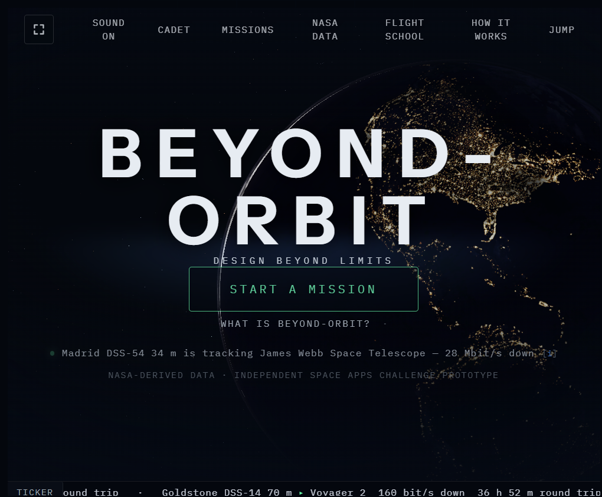
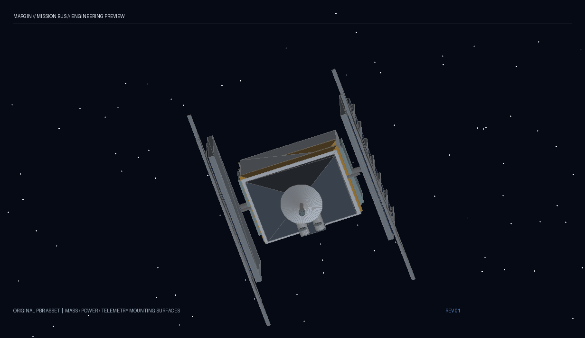
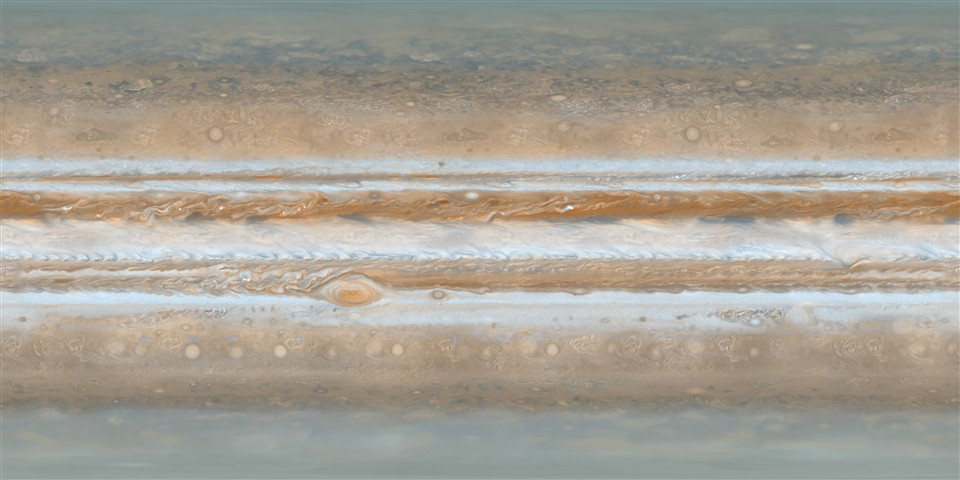
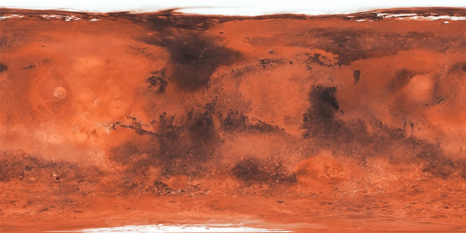
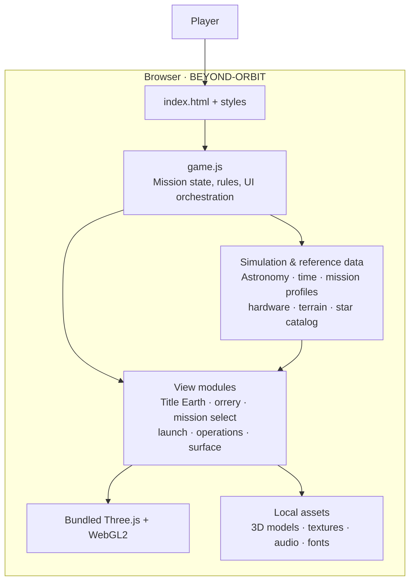

# BEYOND-ORBIT

### An interactive space-mission design and operations simulator

[](https://developer.mozilla.org/en-US/docs/Web/JavaScript)
[](https://threejs.org/)
[](https://developer.mozilla.org/en-US/docs/Web/API/WebGL2RenderingContext)
[](LICENSE)

**Explore space. Design missions. Discover beyond.**

BEYOND-ORBIT is a browser-based mission-design game that turns spacecraft engineering trade-offs into a playable end-to-end mission. Choose a destination, configure a spacecraft and science objectives, fly a launch, then operate the mission while balancing power, fuel, communications, data storage, risk, and time.

The experience combines a 3D Earth and solar-system visualization with NASA/JPL-derived reference data, mission operations, and surface exploration. It is an educational prototype; it is not an official NASA product or a flight-planning tool.

## Project Gallery

<p align="center">
  
</p>
<p align="center"><sub>Title screen · live 3D Earth and mission entry</sub></p>

<table>
  <tr>
    <td align="center" width="50%">
      
      <br /><sub>Spacecraft engineering preview</sub>
    </td>
    <td align="center" width="50%">
      
      <br /><sub>Earth · night-lights map</sub>
    </td>
  </tr>
  <tr>
    <td align="center" width="50%">
      
      <br /><sub>Jupiter · planetary texture</sub>
    </td>
    <td align="center" width="50%">
      
      <br /><sub>Mars · planetary texture</sub>
    </td>
  </tr>
</table>

<sub>Planetary texture attributions and license details: [SOURCES.md](SOURCES.md) and [THIRD_PARTY_NOTICES.md](THIRD_PARTY_NOTICES.md).</sub>

---

## 1. System Architecture

BEYOND-ORBIT runs as a static client-side application. The browser loads the interface, simulation logic, local reference datasets, and bundled rendering libraries; there is no application server or database to configure.



### Runtime flow

1. `index.html` loads the styles, bundled astronomy and terrain datasets, and the game controller.
2. `game.js` owns mission state and coordinates the design, launch, operations, and report screens.
3. View modules render the current phase. Three.js is bundled in `vendor/`; WebGL2 powers the Earth, solar-system, spacecraft, and surface scenes.
4. The simulation reads local reference data and assets. Mission outcomes and science-data generation are simulated in the browser.

### Main components

| Component | Responsibility |
| --- | --- |
| `game.js` | Mission state, spacecraft configuration, gameplay rules, operations, scoring, and screen transitions |
| `js/astronomy.js`, `js/time-service.js` | Ephemeris evaluation, simulation time, and explicit provider/fallback labeling |
| `js/mission-profiles.js`, `js/nasa-hardware-data.js` | Destination-specific architectures and spacecraft subsystem reference data |
| `js/orrery.js`, `js/title-earth.js` | Shared Three.js solar-system renderer and animated title-screen Earth |
| `js/select-viewer.js`, `js/brief-view.js` | Mission selection and mission-brief visualization |
| `js/launch-view.js`, `js/lv-preview.js` | Launch vehicle preview and launch sequence |
| `js/ops-view.js`, `js/surface-view.js` | In-flight mission operations and planetary surface scenes |
| `js/*-data*.js`, `assets/`, `models/` | Vendored ephemerides, terrain, stars, textures, models, and audio |

---

## 2. Features

- **Five mission destinations:** Earth orbit, the Moon, Mars, asteroid Bennu, and Europa.
- **Mission design:** Select science goals and instruments, then balance spacecraft mass, power, cost, propulsion, launch capability, and communications.
- **Launch experience:** Review readiness and follow a visual launch sequence with mission-specific vehicles and flight milestones.
- **Mission operations:** Manage spacecraft resources, science collection, data storage, Deep Space Network support, and operational risk.
- **Surface missions:** Where a mission profile supports it, operate a rover or lander using terrain-aware surface views and exploration objectives.
- **Science data:** Generate simulated science data according to mission and instrument settings, with a maximum modeled generation rate of **500 GB per day**.
- **3D exploration:** View the title-screen Earth and interactive solar-system, spacecraft, launch, and surface scenes.
- **Mission debrief:** Review outcomes, compare against historical mission benchmarks, and see how engineering decisions affected the result.
- **NASA data provenance:** Inspect in-app source notes and the project’s detailed [source register](SOURCES.md).

---

## 3. Engineering Principles & Guardrails

1. **Browser-first, no build step:** The app is served as static files; no package installation or compilation is required.
2. **Local-first simulation:** Ephemerides, terrain datasets, hardware references, Three.js, and visual assets are bundled with the repository. The game does not require a live NASA API for its core simulation.
3. **Physics and presentation are distinct:** Scientific reference values and simulation calculations are kept separate from visual-scale adjustments and procedural rendering.
4. **Fallbacks are explicit:** Ephemeris coverage and fallback providers are identified in the simulation. The `?no3d` URL parameter intentionally disables 3D rendering for the 2D fallback.
5. **Educational scope:** Vehicle performance, costs, mission profiles, and outcomes are simplified models—not operational guidance or official NASA mission designs.

---

## 4. Quickstart

### Prerequisites

- A modern desktop browser with WebGL2 support for the full 3D experience.
- Python 3, or another static HTTP server.
- No Node.js, Python packages, API keys, or build tools are required.

### Run locally

From the repository root, start a local web server:

```powershell
python -m http.server 8000
```

Open **http://localhost:8000/** in your browser. To stop the server, press `Ctrl+C` in the terminal.

> **Use HTTP instead of opening `index.html` directly.** The 3D views use JavaScript ES modules, which browsers restrict on `file://` URLs.

### Optional 2D fallback

If WebGL2 is unavailable or you need to troubleshoot rendering, open:

```text
http://localhost:8000/?no3d
```

This flag deliberately skips the 3D views. Remove `?no3d` to restore the normal 3D experience.

---

## 5. A Typical Mission

1. Start a mission and choose a destination and mission architecture.
2. Review science objectives, select instruments, and assemble the spacecraft.
3. Check mass, power, cost, launch vehicle, communications, and readiness margins.
4. Launch and follow the mission timeline.
5. Operate the spacecraft, manage resources and downlink, and pursue mission objectives.
6. Review the final report, science return, and engineering trade-offs.

---

## 6. Scientific Data & Visual Assets

The project’s [source and scientific provenance register](SOURCES.md) describes the reference datasets, models, and simplifications used by the simulation. [Asset sources](assets/ASSET_SOURCES.md) and [third-party notices](THIRD_PARTY_NOTICES.md) document bundled visual and software assets.

Examples include:

- JPL planetary ephemerides and satellite theories, with explicit fallback behavior.
- NASA/JPL reference data for mission architectures, spacecraft hardware, terrain, and historical mission benchmarks.
- A catalog of stars and planetary textures used in the 3D views.
- NASA spacecraft and surface hardware models, alongside clearly identified procedural reconstructions.

Scientific values and visual assets have distinct sources and licenses. Refer to the provenance and notice files before reusing them. NASA does not endorse this project.

---

## 7. Troubleshooting

| Symptom | What to check |
| --- | --- |
| The page does not load correctly from a file path | Serve the repository over HTTP using the Quickstart instructions. |
| The 3D Earth or other 3D scenes are missing | Confirm the URL does not include `?no3d` and that the browser supports WebGL2. |
| The initial loading screen takes time | The app loads large local ephemeris and texture assets before rendering; wait for initialization or use **ENTER NOW** when it appears. |
| A local change appears not to take effect | Refresh the page and check the browser console for missing files or JavaScript errors. |

---

## 8. Project Layout

```text
.
├── index.html              # App shell, import map, boot sequence, script loading
├── game.js                 # Mission simulation and UI controller
├── js/                     # Astronomy, mission data, and visualization modules
├── styles/                 # Application and loading-screen styles
├── assets/                 # Textures, audio, icons, and asset provenance
├── models/                 # Spacecraft, planetary, and surface models
├── vendor/                 # Bundled Three.js modules and rendering helpers
├── fonts/                  # Bundled font files and font styles
├── SOURCES.md              # Scientific and mission-data provenance
├── THIRD_PARTY_NOTICES.md  # Software, font, and media license notices
└── LICENSE                 # Project license
```

---

## 9. License & Acknowledgements

The project’s original source code is distributed under the [MIT License](LICENSE). Third-party libraries, fonts, datasets, models, textures, and audio may carry separate terms; see [`THIRD_PARTY_NOTICES.md`](THIRD_PARTY_NOTICES.md), [`SOURCES.md`](SOURCES.md), and [`assets/ASSET_SOURCES.md`](assets/ASSET_SOURCES.md).

BEYOND-ORBIT is an independent educational prototype and is not affiliated with or endorsed by NASA or JPL.
